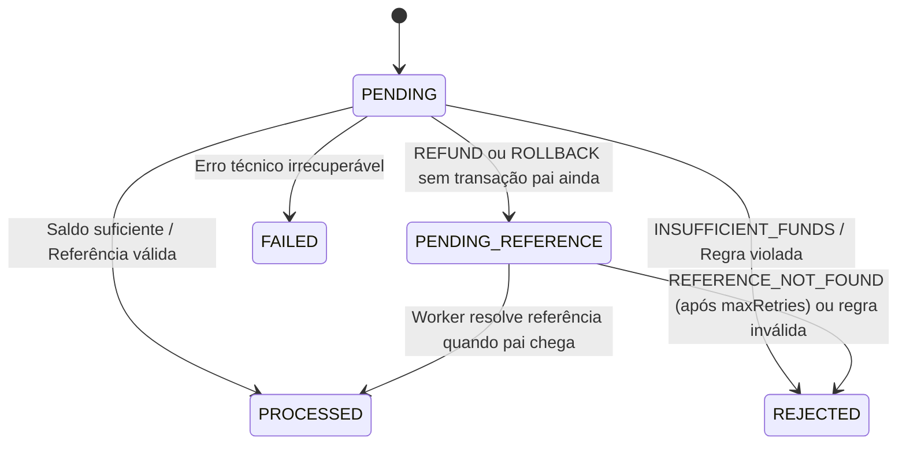

# Arquitetura do Serviço Financeiro de Apostas (`backend-challenge-go`)

Este documento descreve as decisões arquiteturais, invariantes de domínio, estratégias de concorrência, idempotência, mensageria transacional e segurança adotadas na implementação do serviço financeiro de apostas da Jungle Gaming.

---

## 1. Visão Geral e Organização em Camadas (DDD + Clean Architecture)

O sistema foi desenhado separando rigorosamente as regras de negócio puras da infraestrutura externa:

```text
cmd/api/                  -> Ponto de entrada e composição modular via Uber Fx
internal/
  config/                 -> Carregamento de variáveis de ambiente
  domain/
    money/                -> Value Object imutável (int64 em centavos, escala fixa 2, ISO 4217)
    wallet/               -> Agregado Wallet (invariante de saldo >= 0 e controle de versão)
    ledger/               -> Entidade imutável WalletLedgerEntry (append-only)
    transaction/          -> Máquina de estados WagerTransaction e regras por tipo de operação
    idempotency/          -> Serialização JSON canônica determinística e hash SHA-256
    events/               -> Envelopes de eventos de domínio para o Outbox
    repository/           -> Contratos (interfaces) de persistência e gerenciador de transações
  usecase/                -> Casos de uso transacionais (OpenWallet, ProcessWager, ReconcileWallet, etc.)
  worker/                 -> Workers assíncronos (OutboxPublisher e ReferenceResolver)
  infra/
    postgres/             -> Implementação pgx/v5 dos repositórios com SELECT ... FOR UPDATE
    sqs/                  -> Consumidor concorrente com graceful shutdown e publicador AWS SQS FIFO
    auth/                 -> Validador JWT OAuth2/OIDC (Keycloak JWKS RS256 + HMAC HS256) e RBAC
    http/                 -> Roteador HTTP, middlewares de correlação e handlers REST
    metrics/              -> Métricas Prometheus
migrations/               -> Schema SQL e triggers de imutabilidade do Ledger
tests/                    -> Testes automatizados de concorrência, idempotência, workers e HTTP/Auth
```

---

## 2. Representação Monetária (`Money`)

Em sistemas financeiros, tipos de ponto flutuante (`float32`/`float64`) introduzem erros de representação binária IEEE 754 (ex.: `0.1 + 0.2 != 0.3`). Para eliminar qualquer risco de imprecisão:

- **Unidade Mínima (`int64`):** Todo valor monetário é armazenado internamente como `int64` representando centavos (escala fixa de 2 casas decimais). Exemplo: `"100.00"` BRL = `10000` centavos.
- **Imutabilidade e Encapsulamento:** Os campos `cents` e `currency` de `money.Money` são privados. Toda operação aritmética (`Add`, `Sub`) valida compatibilidade de moeda (`ErrCurrencyMismatch`), verifica overflow de `int64` (`ErrOverflow`) e retorna uma **nova** instância de `Money`.
- **Parsing Estrito:** A entrada externa aceita exclusivamente strings decimais canônicas (`"10.50"`, `"10"`, `"0.00"`). Strings contendo notação científica (`"1e2"`), `NaN`, `Infinity`, espaços, mais de 2 casas decimais (`"10.555"`) ou valores negativos em payloads externos são imediatamente rejeitadas com `400 Bad Request`.

---

## 3. Transações SQL, Locking Pessimista por Carteira e Concorrência

### 3.1. Estratégia de Isolamento e Lock (`SELECT ... FOR UPDATE`)
Para proteger o saldo contra condições de corrida (*lost updates* e *double spending*) sob múltiplas goroutines e múltiplas instâncias da aplicação:

1. O caso de uso abre uma transação SQL (`READ COMMITTED`) via `DBTransactionManager`.
2. Adquire um **lock pessimista exclusivo na linha da carteira** (`SELECT ... FROM wallets WHERE id = $1 FOR UPDATE`).
3. Transações concorrentes na **mesma carteira** são serializadas pelo PostgreSQL na fila de lock da linha, garantindo que a segunda transação leia o saldo já atualizado pela primeira.
4. Transações em **carteiras distintas** bloqueiam linhas distintas e avançam 100% em paralelo sem contenção global.
5. Além do lock pessimista, o `UPDATE wallets SET balance = $1, version = $2 WHERE id = $3 AND version = $4` valida a versão do agregado, incrementando `version` exclusivamente quando há alteração efetiva de saldo.

### 3.2. Caso Obrigatório: Duas Apostas Simultâneas de 80.00 BRL em Saldo de 100.00 BRL
Quando duas requisições `BET` de `80.00 BRL` chegam simultaneamente para uma carteira com `100.00 BRL`:
- A primeira adquire o `FOR UPDATE`, debita `80.00 BRL`, grava o lançamento `DEBIT` no `wallet_ledger` (`balance_before = 10000`, `balance_after = 2000`), atualiza `wallets.balance = 2000` (`version = 2`), registra os eventos `WalletBalanceChanged` e `WagerTransactionProcessed` no `outbox_events` e faz `COMMIT`.
- A segunda adquire o `FOR UPDATE` logo em seguida, enxerga `balance = 2000` (`20.00 BRL`), falha na invariante de débito (`INSUFFICIENT_FUNDS`), persiste a transação como `REJECTED` com `balance_at_process = 2000` e evento `WagerTransactionRejected` no Outbox, **sem gerar entrada no ledger** e **sem incrementar a versão da carteira**.

---

## 4. Ledger Imutável (Append-Only) e Reconciliação Contábil

A tabela `wallet_ledger` é a fonte contábil da verdade:
- Possui `UNIQUE (wallet_id, transaction_id)` impedindo que uma mesma transação gere mais de um lançamento na carteira.
- Valida no domínio e no banco que `amount > 0` e que `balance_after = balance_before + amount` (para `CREDIT`) ou `balance_after = balance_before - amount` (para `DEBIT`).
- Possui uma **trigger PostgreSQL (`trg_protect_wallet_ledger`)** que bloqueia qualquer tentativa de `UPDATE` ou `DELETE` na tabela `wallet_ledger` lançando exceção imediata.
- O endpoint `POST /wallets/{walletId}/reconciliation` recalcula o saldo somando todos os créditos e subtraindo todos os débitos do ledger e compara com `wallets.balance`. Caso haja divergência (`consistent: false`), incrementa a métrica `wager_reconciliation_divergences_total` e emite log estruturado de alerta.

---

## 5. Idempotência Canônica e Deduplicação Multi-Canal

### 5.1. Hash SHA-256 de JSON Canônico
O cálculo do `payload_hash` (`internal/domain/idempotency/canonical.go`) utiliza uma estrutura canônica com chaves ordenadas deterministicamente contendo apenas os atributos semânticos do negócio (`providerId`, `externalTransactionId`, `playerId`, `walletId`, `roundId`, `gameId`, `kind`, `amount`, `currency`, `referenceExternalTransactionId`), ignorando `Idempotency-Key`, cabeçalhos de transporte e `correlationId`.

### 5.2. Regras de Conflito e Replay
- **Mesma `(provider_id, idempotency_key)` + mesmo `payload_hash`:** Retorna o resultado original persistido (`idempotentReplay: true`) com o snapshot exato de saldo da época do processamento (`balance_at_process`), sem reexecutar efeitos colaterais.
- **Mesma `(provider_id, idempotency_key)` + `payload_hash` diferente:** Retorna `409 Conflict` (`ErrPayloadConflict`).
- **Mesmo `(provider_id, external_transaction_id)` com outra `idempotency_key`:** Retorna `409 Conflict` (`ErrExternalIDReused`).
- **Deduplicação dentro do Lock:** Após adquirir o lock da carteira (`GetByIDForUpdate`), o caso de uso revalida a chave de idempotência dentro da transação para proteger contra chamadas idênticas que chegaram exatamente no mesmo microssegundo.

---

## 6. Máquina de Estados de `WagerTransaction`, `PENDING_REFERENCE` e Combinações de Reversão

### 6.1. Estados e Transições


### 6.2. Resolução Assíncrona de Referências Fora de Ordem (`PENDING_REFERENCE`)
Em sistemas distribuídos com filas e múltiplos provedores, um `REFUND` ou `ROLLBACK` pode chegar antes da `BET` original:
1. Se `referenceExternalTransactionId` ainda não existir no banco, a transação é salva com estado `PENDING_REFERENCE`, `retry_count = 0`, `next_retry_at = NOW() + 1s`, e o evento `WagerTransactionPendingReference` é gravado no Outbox (HTTP retorna `202 Accepted`).
2. O worker `ReferenceResolver` consulta periodicamente transações em `PENDING_REFERENCE` cujo `next_retry_at <= NOW()`.
3. Se a transação referenciada já tiver chegado e estiver `PROCESSED`, o worker adquire o `FOR UPDATE` da carteira, aplica o crédito/débito correspondente, grava no Ledger, muda o estado para `PROCESSED` e emite `WalletBalanceChanged` + `WagerTransactionProcessed`.
4. Se a referência ainda não existir, incrementa `retry_count` com **exponential backoff** ($2^{\text{retryCount}} \text{ segundos}$). Ao atingir `maxRetries` (5 tentativas), transiciona definitivamente para `REJECTED` com `failureCode = REFERENCE_NOT_FOUND` e emite `WagerTransactionRejected`.

### 6.3. Matriz de Combinações `REFUND` e `ROLLBACK`
| Operação | Referência Alvo | Estado da Referência | Condição Adicional | Resultado |
| :--- | :--- | :--- | :--- | :--- |
| `REFUND` | `BET` | `PROCESSED` | Valor igual ao da `BET` e sem reversão prévia | `PROCESSED` (`CREDIT` no ledger) |
| `REFUND` | `WIN` / `LOSS` / `REFUND` / `ROLLBACK` | Qualquer | `REFUND` só é permitido sobre `BET` | `REJECTED` (`INVALID_REFERENCE_OPERATION`) |
| `ROLLBACK` | `BET` | `PROCESSED` | Valor igual ao da `BET` e sem reversão prévia | `PROCESSED` (`CREDIT` no ledger) |
| `ROLLBACK` | `WIN` ou `REFUND` | `PROCESSED` | Carteira possui saldo suficiente para estornar o crédito | `PROCESSED` (`DEBIT` no ledger) |
| `ROLLBACK` | `WIN` ou `REFUND` | `PROCESSED` | Carteira **não** possui saldo suficiente para o débito reverso | `REJECTED` (`REVERSAL_EXCEEDS_BALANCE`) |
| `REFUND` ou `ROLLBACK` | Qualquer | `REJECTED` / `PENDING` / `FAILED` | Referência não está em `PROCESSED` | `REJECTED` (`INVALID_REFERENCE_STATE`) |
| `REFUND` ou `ROLLBACK` | `BET` / `WIN` / `REFUND` | `PROCESSED` | Referência já sofreu um `REFUND` ou `ROLLBACK` processado | `REJECTED` (`DUPLICATE_REVERSAL`) |

> **Garantia no Banco de Dados:** O índice único parcial `uq_transactions_processed_reversal ON wager_transactions(resolved_internal_reference_id) WHERE kind IN ('REFUND', 'ROLLBACK') AND state = 'PROCESSED'` garante no nível do PostgreSQL que jamais existirão duas reversões processadas para a mesma transação de origem.

---

## 7. Transactional Inbox, Transactional Outbox e SQS FIFO

- **Transactional Inbox (`inbox_messages`):** Toda mensagem recebida da fila `wager-transactions.fifo` é registrada na tabela `inbox_messages` com constraint `UNIQUE (consumer_name, message_id)` **dentro da mesma transação SQL** que altera a carteira e o ledger. Se o SQS reentregar a mensagem após o commit (por falha de rede no `DeleteMessage`), o Inbox detecta a duplicata imediatamente.
- **Transactional Outbox (`outbox_events`):** Nenhum caso de uso publica diretamente no SQS durante a transação de banco (evitando *dual writes*). Os eventos são inseridos em `outbox_events` na mesma transação ACID da mudança de estado.
- **Concorrência no Outbox Publisher (`FOR UPDATE SKIP LOCKED`):** O worker `OutboxPublisher` busca lotes de eventos pendentes usando `SELECT ... FROM outbox_events WHERE status = 'PENDING' AND next_retry_at <= NOW() ORDER BY created_at ASC LIMIT $1 FOR UPDATE SKIP LOCKED`. Isso permite escalar múltiplas instâncias da aplicação publicando no SQS FIFO (`wager-events.fifo`) sem bloqueio mútuo e sem publicações duplicadas, usando `EventID` como `MessageDeduplicationId` e `WalletID` como `MessageGroupId`.

---

## 8. Autenticação OAuth2/OIDC (Keycloak) e Isolamento entre Provedores

- O `JWTValidator` valida tokens JWT assinados via **RS256** (buscando e fazendo cache das chaves públicas no endpoint JWKS `/protocol/openid-connect/certs` do Keycloak) ou **HS256** (para testes automatizados).
- **RBAC para Endpoints Internos:** As rotas de gestão de carteira (`POST /wallets`, `GET /wallets/{walletId}`, `GET /wallets/{walletId}/ledger`, `POST /wallets/{walletId}/reconciliation`) exigem a role `internal` ou `admin` (cliente `internal-service`). Provedores externos recebem `403 Forbidden`.
- **Isolamento Estrito de Provedor (`providerId`):** Nas rotas de transações (`POST /wagering/transactions`, `GET /wagering/transactions/{transactionId}`, `GET /providers/{providerId}/wagering/transactions/{externalTransactionId}`), o `providerId` extraído das claims do token JWT deve coincidir exatamente com o `providerId` do payload/recurso. Um provedor (`provider-a`) nunca consegue criar, consultar ou fazer replay de transações pertencentes a outro provedor (`provider-b`), recebendo `403 Forbidden`.

---

## 9. Ciclo de Vida com Uber Fx e Graceful Shutdown

Toda a árvore de dependências é construída via `go.uber.org/fx` (`fx.Provide`, `fx.Annotate`, `fx.Invoke`). Quando o processo recebe `SIGINT` ou `SIGTERM`, os hooks `OnStop` do `fx.Lifecycle` executam na ordem segura:
1. O servidor HTTP para de aceitar novas conexões (`server.Shutdown`) e aguarda requisições em andamento.
2. O consumidor SQS fecha o `stopCh` e aguarda o `sync.WaitGroup` de todas as mensagens em processamento terminarem antes de retornar.
3. Os workers `OutboxPublisher` e `ReferenceResolver` concluem o lote atual e encerram seus loops.
4. O pool de conexões PostgreSQL (`pgxpool.Pool`) é fechado com segurança.

---

## 10. Trade-offs e Limitações Conhecidas

1. **Locking Pessimista (`SELECT ... FOR UPDATE`) vs. Locking Otimista Puro:** Optamos pelo lock pessimista na linha da carteira combinado com checagem de versão porque, em cenários de alta contenção em uma mesma carteira (ex.: rajadas de apostas/resoluções simultâneas do mesmo jogador), o lock otimista puro geraria alta taxa de abortos e retries na aplicação, enquanto o `FOR UPDATE` enfileira as operações no PostgreSQL com baixa latência e determinismo.
2. **Polling no Outbox e ReferenceResolver vs. CDC (Debezium):** O uso de workers baseados em polling com `FOR UPDATE SKIP LOCKED` mantém a arquitetura simples, auto-contida em Go e sem dependências operacionais extras (como Kafka Connect/Debezium), ao custo de uma pequena latência de polling (~300ms no Outbox e ~1s no ReferenceResolver).
